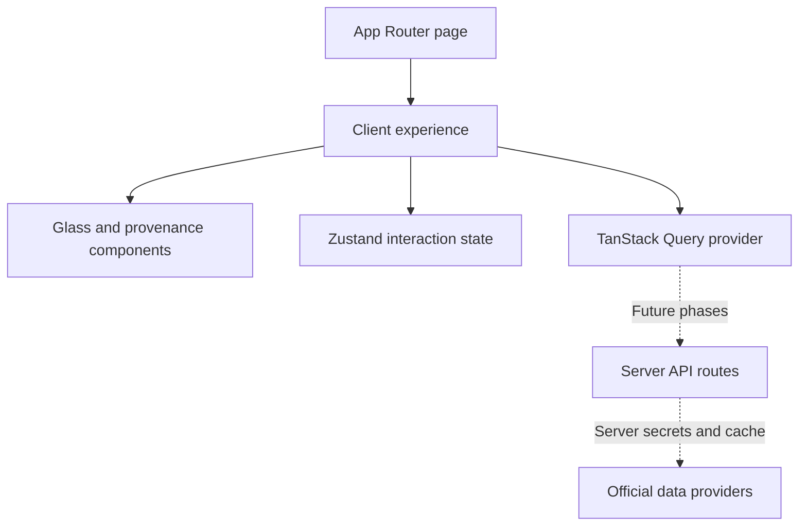

# BREATHE

A little perspective. A better breath.

An original air quality intelligence platform for Lets Code Diwali Challenge 2026: Breathe Better. Individual entry. Work began on 8 November 2026. This repository is the **Phase 1 foundation**, not the completed hackathon submission.

## Run locally

Requires Node 20.9+ and npm.

```sh
npm install
cp .env.example .env.local
npm run dev
```

Open http://localhost:3000. No credentials are required for Phase 1. Click **Enter BREATHE** to open the exploration shell. The entry gesture resumes a silent AudioContext when supported; no radio is claimed to be playing. Audio failure never blocks entry.

```sh
npm run lint
npm run typecheck
npm test
npm run build
```

Commit the generated package-lock.json once installation succeeds, then use npm ci in CI. Dependency ranges are declared; exact dependency resolution is pending registry connectivity.

## Phase status

| Phase | Scope | Status |
| --- | --- | --- |
| 1 | Scaffold, tokens, glass primitives, splash | Implemented; execution checks blocked by registry DNS |
| 2 | globe.gl, Open-Meteo, city search, pins | Planned |
| 3 | Radio Browser, playback, crossfade | Planned |
| 4 | OpenAQ, provenance, resilient proxy/cache | Planned |
| 5 | History, comparison, health, forecast; first deploy | Planned |
| 6 | Deep links, layers, terminator, cigarette equivalent, roulette | Planned |
| 7 | Diwali comparison, breathing, sounds | Planned |
| 8 | Wind, PWA/offline, bonuses in priority order | Planned |
| 9 | Accessibility, performance, final documentation/deploy | Planned |

## Implemented

- Next.js App Router, TypeScript, Tailwind 4, Framer Motion, Zustand, TanStack Query provider.
- Responsive entry experience with original procedural planet illustration (decorative, **not a map or data visualization**).
- Reusable frosted-glass surface with cursor highlight and clean backdrop-filter fallback.
- Keyboard entry, skip link, visible focus, credits dialog focus containment, Escape dismissal and focus restoration.
- Reduced-motion support and a manual low-power toggle that removes backdrop blur.
- Five provenance badge variants, with dashed forecast and explicit stale / Not live treatment.
- Typed reading contract, missing-reading formatter that preserves real zero, truthful empty pollutant states.
- Tests for missing values, entry with unavailable audio, and dialog keyboard dismissal.

## Data integrity and credits

No AQI readings are hardcoded. No sources are connected in this release. Empty readings show “No data”; pollutants show “N/A”; source and update time are explicitly unavailable. The atmospheric illustration conveys no pollution data.

Planned sources (official contracts must be checked immediately before their integration):

- [Open-Meteo Air Quality](https://open-meteo.com/en/docs/air-quality-api): CAMS modeled data, forecast, supported recent history.
- [Open-Meteo Weather](https://open-meteo.com/en/docs): wind and weather context.
- [OpenAQ v3](https://docs.openaq.org/): station measurements. Concentration values must not be mislabeled as AQI.
- [Radio Browser](https://api.radio-browser.info/): station directory, HTTPS stream filtering and click registration.
- Reverse geocoding provider: to be chosen after policy verification.
- [Berkeley Earth](https://berkeleyearth.org/air-pollution-and-cigarette-equivalence/): approximate PM2.5 cigarette equivalence; not yet implemented.

US AQI is the planned primary scale. API keys will be read only by server routes. Future data contracts must carry source, observation time, fetch time, and MEASURED / MODELED / FORECAST / HISTORICAL / STALE type. Cached fallback must say Not live. The app must not imply fireworks causation from festival-time correlations.

## Architecture



`src/app` owns routes and global tokens; `src/components` owns the presentation; `src/store` owns interaction state; `src/lib` owns domain contracts. Heavy globe and charts will be dynamically imported in their phases.

## Environment

| Variable | Required now | Planned use |
| --- | --- | --- |
| OPENAQ_API_KEY | No | Server-only OpenAQ v3 requests |
| OPENAI_API_KEY | No | Optional grounded assistant server route |

Never put secrets in NEXT_PUBLIC_ variables or commit .env.local.

## Vercel deployment

1. Install dependencies and pass all four checks above.
2. Push this repository to your Git provider and import it in Vercel as Next.js.
3. Set server-only variables in Vercel project settings when the corresponding integration ships.
4. Use the default `npm run build` build command. Preview each phase; the first submission deployment is scheduled after Phase 5.

## Known limitations / verification

Dependency installation failed in this execution environment: `getaddrinfo ENOTFOUND registry.npmjs.org`. Lint, typecheck, tests, production build, browser QA, and Lighthouse **have not passed or run successfully**. The source is scaffolded for deployment but deployability has not been verified. No API keys are needed to unblock Phase 1; npm connectivity is needed.

The planet is a CSS illustration pending the actual interactive 3D globe. No search, map, live radio, history, forecast, comparison, health dashboard, or signature features are claimed complete. No screenshots are included until browser rendering can be verified. The light OS preference uses higher-contrast foregrounds while preserving the explicitly requested dark-space aesthetic. SVG refraction is deferred pending browser/performance checks; plain frosted glass is the fallback.

See [demo outline](docs/DEMO_SCRIPT.md) and [phase record](docs/PHASES.md).
