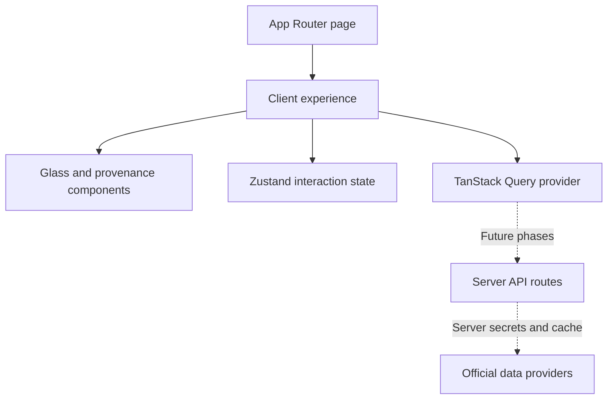

# BREATHE

A little perspective. A better breath.

An original air quality intelligence platform for Lets Code Diwali Challenge 2026: Breathe Better. Individual entry. Work began on 8 November 2026. This repository contains the Phase 1 foundation and a **partial Phase 2 implementation**, not the completed hackathon submission.

## Run locally

Requires Node 22.12+ and npm (the pending Vitest 5 security upgrade requires Node 22.12+).

```sh
npm install
cp .env.example .env.local
npm run dev
```

Open http://localhost:3000. No credentials are required for Phase 1. Click **Enter BREATHE** to open the exploration shell. The entry gesture resumes a silent AudioContext when supported; no radio is claimed to be playing. Audio failure never blocks entry.

```sh
npm run lint
npm run typecheck
npm test
npm run build
```

Commit the generated package-lock.json once installation succeeds, then use npm ci in CI. Dependency ranges are declared; exact dependency resolution is pending registry connectivity.

## Phase status

| Phase | Scope | Status |
| --- | --- | --- |
| 1 | Scaffold, tokens, glass primitives, splash | Implemented; execution checks blocked by registry DNS |
| 2 | globe.gl, Open-Meteo, city search, pins | Partial source implementation; runtime checks blocked |
| 3 | Radio Browser, playback, crossfade | Core implemented; live verification and region fallback pending |
| 4 | OpenAQ, provenance, resilient proxy/cache | Implemented; API key and live verification pending |
| 5 | History, comparison, health, forecast; first deploy | Planned |
| 6 | Deep links, layers, terminator, cigarette equivalent, roulette | Planned |
| 7 | Diwali comparison, breathing, sounds | Planned |
| 8 | Wind, PWA/offline, bonuses in priority order | Planned |
| 9 | Accessibility, performance, final documentation/deploy | Planned |

## Implemented

- Next.js App Router, TypeScript, Tailwind 4, Framer Motion, Zustand, TanStack Query provider.
- Responsive entry experience with original procedural planet illustration (decorative, **not a map or data visualization**).
- Reusable frosted-glass surface with cursor highlight and clean backdrop-filter fallback.
- Keyboard entry, skip link, visible focus, credits dialog focus containment, Escape dismissal and focus restoration.
- Reduced-motion support and a manual low-power toggle that removes backdrop blur.
- Five provenance badge variants, with dashed forecast and explicit stale / Not live treatment.
- Typed reading contract, missing-reading formatter that preserves real zero, truthful empty pollutant states.
- Tests for missing values, entry with unavailable audio, and dialog keyboard dismissal.

## Data integrity and credits

No AQI readings are hardcoded. A server route for Open-Meteo is implemented but has not been runtime-verified. Missing readings show “No data”; unavailable pollutants show “N/A”. Source and observation timestamps accompany data when available. The atmospheric illustration conveys no pollution data.

Planned sources (official contracts must be checked immediately before their integration):

- [Open-Meteo Air Quality](https://open-meteo.com/en/docs/air-quality-api): CAMS modeled data, forecast, supported recent history.
- [Open-Meteo Weather](https://open-meteo.com/en/docs): wind and weather context.
- [OpenAQ v3](https://docs.openaq.org/): station measurements. Concentration values must not be mislabeled as AQI.
- [Radio Browser](https://api.radio-browser.info/): station directory, HTTPS stream filtering and click registration.
- Reverse geocoding provider: to be chosen after policy verification.
- [Berkeley Earth](https://berkeleyearth.org/air-pollution-and-cigarette-equivalence/): approximate PM2.5 cigarette equivalence; not yet implemented.

US AQI is the planned primary scale. API keys will be read only by server routes. Future data contracts must carry source, observation time, fetch time, and MEASURED / MODELED / FORECAST / HISTORICAL / STALE type. Cached fallback must say Not live. The app must not imply fireworks causation from festival-time correlations.

## Architecture



`src/app` owns routes and global tokens; `src/components` owns the presentation; `src/store` owns interaction state; `src/lib` owns domain contracts. Heavy globe and charts will be dynamically imported in their phases.

## Environment

| Variable | Required now | Planned use |
| --- | --- | --- |
| OPENAQ_API_KEY | No | Server-only OpenAQ v3 requests |
| OPENAI_API_KEY | No | Optional grounded assistant server route |

Never put secrets in NEXT_PUBLIC_ variables or commit .env.local.

## Vercel deployment

1. Install dependencies and pass all four checks above.
2. Push this repository to your Git provider and import it in Vercel as Next.js.
3. Set server-only variables in Vercel project settings when the corresponding integration ships.
4. Use the default `npm run build` build command. Preview each phase; the first submission deployment is scheduled after Phase 5.

## Known limitations / verification

Dependency installation failed in this execution environment: `getaddrinfo ENOTFOUND registry.npmjs.org`. Lint, typecheck, tests, production build, browser QA, and Lighthouse **have not passed or run successfully**. The source is scaffolded for deployment but deployability has not been verified. No API keys are needed to unblock Phase 1; npm connectivity is needed.

The planet is a CSS illustration pending the actual interactive 3D globe. No search, map, live radio, history, forecast, comparison, health dashboard, or signature features are claimed complete. No screenshots are included until browser rendering can be verified. The light OS preference uses higher-contrast foregrounds while preserving the explicitly requested dark-space aesthetic. SVG refraction is deferred pending browser/performance checks; plain frosted glass is the fallback.

See [demo outline](docs/DEMO_SCRIPT.md) and [phase record](docs/PHASES.md).

## Phase 2 source checkpoint

Implemented, not runtime-verified: dynamically loaded globe.gl; 16 starter cities; pin/drop rings; fly-to; city search; geolocation; four removable pins; six-pollutant detail; continuous OKLCH colour; cached server proxy; bounded 429/5xx retries; failure and missing-data states. Stale age is conservatively flagged after two hours, or when a client revalidation fails. API current data is MODELED, never MEASURED. Source and observation/retrieval timestamps are shown. Past and forecast hours are fetched but not yet displayed.

Pending before Phase 2 acceptance: ~150 cities and global grid; batched heat surface and top/bottom 10;  24h sparkline; real 2D MapLibre fallback; pin spring and AQI-coloured rings; texture vendoring and day/night treatment. A lazy MapLibre 2D map and automatic globe-failure switching are now implemented in source; browser verification is pending. Both maps use WebGL, so the city list remains the alternative when WebGL is entirely unavailable.

Official documentation checked 8 November 2026: Open-Meteo supports multi-coordinate requests, current us_aqi, pollutant concentrations, hourly data and recent past_days. globe.gl uses `new Globe(element)`, `onGlobeClick` and `pointOfView`. Current scope requests one past day and five forecast days; no unsupported historical years are enabled. Models include CAMS global / European products; retain attribution to Open-Meteo and Copernicus Atmosphere Monitoring Service / CAMS ENSEMBLE as applicable. Earth-night texture currently references the globe.gl / three-globe example asset hosted on unpkg; validate its upstream attribution/licensing and vendor it before submission.

The full `src/lib/air.ts` starter list contains coordinates only, never AQI fixtures. No live provider responses or performance results have been fabricated.

### Phase 2 timeline and map checkpoint

- Added lazy MapLibre GL JS view, colored GeoJSON markers, pin selection and camera movement. Official MapLibre Map and GeoJSONSource documentation checked 8 November 2026.
- Natural Earth public-domain country geometry is fetched from its upstream GitHub repository; attribution is shown by the map. Offline geography / asset vendoring remains pending.
- Added hourly timeline (-24h to +96h from the current provider hour). AQI uses exact returned hours; missing frames are No data, without interpolation. Forecast badge and timeline border are dashed. Historical hours remain modeled output, identified as HISTORICAL with the model disclaimer. Pollutants are hidden outside Now because only AQI and PM2.5 hourly fields are fetched.
- Nine dependency-free Node assertions passed for frame lookup, real zero, missing hours, frame types, coordinate validation, category and number parsing. Added corresponding Vitest timeline tests. Full lint / tsc / Vitest / build remain blocked by absent dependencies and npm DNS failure.
- Still pending: expanded global sampling, heat surface, sparkline, health recommendation, full provenance handling and visual QA. Phase 2 is not yet accepted.

### Global sampling and trend checkpoint

Added 84 fixed global sampling coordinates in six bounded batches (14 coordinates per provider request), alongside 16 starter cities. Coordinate metadata never substitutes for air readings. Missing batches remain missing; the UI shows the loaded batch count. A hex layer averages only available returned AQI values inside each sampled bin; this is a coarse model visualization, not continuous measured coverage. City expansion to approximately 150 and top/bottom ranking remain pending.

Added lazy Recharts 24-hour history, no bridging of null gaps, and a keyboard-readable hourly list. The historical chart is labeled HISTORICAL / CAMS modeled data with its end time. Stale detail readings now retain their FORECAST / HISTORICAL / MODELED badge in addition to STALE. Normalized server payloads use a persistent 15-minute Next cache so retrieval timestamps survive revalidation.

Ten dependency-free sampling / time-series assertions passed in Node. Corresponding Vitest coverage was added. Full lint, typecheck, tests, build and browser verification remain blocked by missing installed dependencies. This remains partial Phase 2 source, not a tested release.

### Phase 2 final source checkpoint

The catalog now contains 150 distinct city coordinates plus 84 global grid samples. City requests are split into bounded 14-coordinate batches. The available-city ranking shows the lowest and highest ten loaded city AQIs at the selected frame; it explicitly does not claim a worldwide ranking. Hotspot rings use available sampled values. Pin markers and spring detail-card entry are implemented. Local pinned data participates in the globe coloring.

The location card includes sourced, general AirNow guidance and the Berkeley Earth approximation only when all 24 unique hourly modeled PM2.5 values exist. Eight additional direct Node assertions passed for catalog size, uniqueness, bounds, rankings, missing data and the complete-day requirement. Full Vitest equivalents are included.

**Acceptance status:** source implementation has advanced, but Phase 2 is not verified complete. npm continues to fail with ENOTFOUND. Required lint, TypeScript, Vitest, production build and browser checks cannot run. Motion quality, pin drop/count-up polish, texture readiness, performance, responsiveness, API response contracts and deployment must be verified before Phase 2 acceptance. No real API response, deployed build, screenshot or Lighthouse result is claimed. Radio remains Phase 3.

## Verification update — 8 November 2026

Dependencies were installed from the user's Terminal. ESLint, TypeScript and all 19 Vitest tests now pass. Production compilation, prerendering and trace generation passed with Next's webpack builder. The default Turbopack builder failed inside the restricted execution environment while attempting to bind a port for CSS processing; `npm run build` now selects the verified webpack builder. Earlier blocked-check records describe previous checkpoints, not these current results.

The user's npm install reported 12 vulnerabilities (9 moderate, 3 critical). The detailed audit cannot be retrieved from the agent environment because registry DNS remains blocked. Vulnerability triage is pending the user's `npm audit --json` output; no forced dependency upgrades or claim of security clearance has been made. Browser, live API, animation and performance QA remain pending.

### Security remediation prepared — 8 November 2026

The supplied audit identifies MapLibre <=6.4.0, Vitest/mocker/tinypool, and the minimatch chain under TypeScript ESLint. Prepared MapLibre ^6.17.0 and Vitest ^5.1.0, plus a scoped minimatch ^11.0.1 override under @typescript-eslint/typescript-estree to avoid npm's suggested Next ESLint major downgrade. The scoped override crosses a major version and requires lint regression verification. Node minimum raised to 22.12 for Vitest 5. Existing Node 24 meets this requirement.

Installation still fails from the agent environment (ENOTFOUND). package-lock.json and node_modules therefore still describe the prior versions. Run npm install in the user's Terminal, then npm audit --json; re-run lint, typecheck, tests and build before committing the dependency migration. Prior passing checks apply to the earlier dependency set only. No clean audit or upgraded-version compatibility is claimed yet.

### Security migration verified — 8 November 2026

The user's post-install npm audit reports zero known vulnerabilities. Resolved versions: MapLibre 6.17.0, Vitest 5.1.0, and the scoped minimatch dependency 11.0.5. Tinypool is absent from the resolved tree. The updated lockfile is committed with the manifest. ESLint, TypeScript, all 19 tests across six files, and the production webpack build passed against the upgraded versions. This supersedes the pending-install status above. Browser interaction and live external API QA remain separate outstanding checks; a clean audit is not a guarantee that software has no vulnerabilities.

## Phase 3 radio checkpoint

Official Radio Browser directory and mirror API documentation checked 8 November 2026. Implemented DNS discovery through all.api.radio-browser.info, reverse-lookup hostname validation, randomized discovered mirrors and fallback hosts, descriptive User-Agent, HTTPS directory requests, bounded mirror failover and 20-minute normalized cache. Discovery uses geo-distance within 150 km, then explicitly labelled regional alternatives within 1,500 km. Station candidates require lastcheckok=1, MP3/AAC/AAC+ and an HTTPS url_resolved; HLS is excluded. The directory is community-maintained and does not guarantee stream uptime.

The native-element player includes play/pause, previous/next, station list, logo fallback, decorative equalizer, mute, persisted volume/mute, a 600ms two-stream crossfade, 220ms mute fade, 12s connection timeout, bounded failed-station skipping, no-stream and offline states. It makes no CORS-dependent audio analysis requests. Successful playback registers a Radio Browser click via a same-origin server route. Browser autoplay may still require tapping Play; AudioContext unlock alone cannot guarantee remote media playback permission.

Pending Phase 3 acceptance: reverse-geocoded country/state fallback, a verified per-element gesture unlock, live mirror/stream checks and browser QA. Public Nominatim was not integrated: its application-wide 1 request/second policy requires a shared rate limiter across Vercel instances. BigDataCloud's free endpoint is client-only and is not appropriate for a server proxy. Geo-distance results remain clearly labelled as directory matches rather than inferred location identity. No unsupported claim that a selected station is in the pinned country is made.

Validation: lint, typecheck, 24 tests (including secure station filtering and native-element crossfade/mute cleanup), and production build pass before the final logo addition; the final checks below are recorded in docs/PHASES.md. Network runtime testing and visual checks are separate from these build results.

## Phase 4 station measurements

Added /api/station, server-only OPENAQ_API_KEY authentication, a 25 km fixed-station search (up to 1,000 returned locations), coordinate-based nearest selection, latest sensor joins, native concentration units and per-sensor observation times. Station concentrations never replace or masquerade as the modeled US AQI. Negative/missing/nonfinite values, unknown sensors and invalid timestamps are excluded. If more than 1,000 stations exist inside the radius, the selected station is nearest among returned candidates; exhaustive pagination is not implemented.

The panel preserves cached readings on client refresh failure, labels them STALE / Not live, flags readings older than two hours conservatively, and provides provider attribution. Normalized server data uses a 15-minute Next cache, preserving original retrieval times. A shared provider client now handles OpenAQ and Open-Meteo retries with bounded exponential backoff. It respects Retry-After and OpenAQ x-ratelimit-reset; cooldowns over four seconds return a nonblocking unavailable response rather than violating provider limits. No automatic station polling is used.

### Enable measurements locally

Register at https://explore.openaq.org/register. Add OPENAQ_API_KEY to .env.local (copy the template if needed), then restart the development server. Never paste the key into chat or put it in a NEXT_PUBLIC_ variable. The key is absent in the current local setup, so live OpenAQ validation remains pending. Add the same server-only variable in Vercel before deployment.

Official OpenAQ v3 location/latest, geospatial, authentication and rate-limit documentation checked 8 November 2026. General quotas are 60/minute and 2,000/hour per API key; caching and bounded per-pin queries reduce usage. Shared cross-instance quota budgeting and complete provider-license metadata need verification before a public high-traffic deployment. Earlier phase checkpoints remain historical; the current source includes the station integration described here.

## Visual refinement and Phase 5

Both entry and explorer now use a realistic, locally bundled Blue Marble globe and elevation bump map. The entry falls back to a texture-based sphere if WebGL fails. The glass layout uses responsive grid/flex flow, smooth native scrolling, quieter borders and shadows, and reduced-motion-aware transitions. Earth assets are copied from the installed three-globe package example imagery; its MIT license is bundled at public/textures/THREE-GLOBE-LICENSE.txt and the upstream project is credited in-app. The welcome Earth is decorative and conveys no air quality readings.

Phase 5 adds recent seven-day modeled history, date-to-date percentage comparisons, daily means, PM2.5/PM10 comparison, rolling 2σ spike flags, up to four pinned-location trend overlays and pollutant differences, health guidance, and dashed hourly/daily forecast charts. Daily summaries explicitly mean available hourly model AQI, not regulatory daily AQI. Coverage counts disclose partial UTC days. History range is intentionally limited to seven days despite the documented larger past_days limit. No archive-year availability is implied.

Insights include keyboard dialog containment and focus restoration. Modeled comparison rankings are labelled as such; measured historical comparisons are not implemented. Deployment is still pending: no Vercel CLI/account is available in the restricted environment. No public URL or screenshots are claimed.

## Phase 6 started

Added validated coordinate/time deep links with copy-link control, back/forward restoration after Enter, AQI / hotspot / pin layer toggles, and real-data Good-air roulette avoiding the last five choices. ISO times are rounded to the nearest hourly frame; relative offsets are constrained to the currently available -24h / +96h scrubber range. Invalid query values fall back safely. The splash still gates entry and audio. Clipboard failure is nonblocking.

Validation: lint, typecheck, all 41 tests and the production webpack build pass. Phase 6 remains in progress: solar day/night terminator, OG preview generation, and wind controls are not implemented. Public deployment and visual browser QA remain pending; there is no linked Vercel project or installed Vercel CLI in this workspace. The UI refinements can be reviewed by refreshing the user's running dev server.
