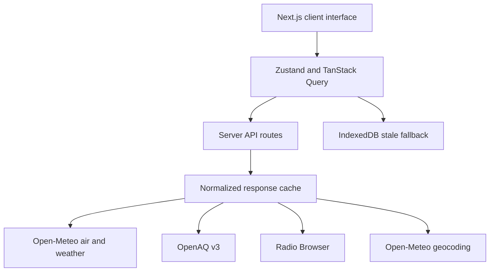

# BREATHE

Explore the air we share. BREATHE combines a realistic interactive Earth, sourced air quality, local radio and tools for understanding pollution over time.

Built for **Lets Code Diwali Challenge 2026: Breathe Better**, theme: Technology for Cleaner Air. Individual entry. This repository is a release candidate; a public deployment and browser acceptance checks are still pending.

## Run locally

Requires Node.js 22.12 or newer and npm. Install from the committed lockfile:

```sh
npm ci
test -f .env.local || cp .env.example .env.local
npm run dev
```

Add your OpenAQ key to `.env.local`. Obtain it through the [OpenAQ platform](https://explore.openaq.org/). Modeled air quality and radio do not require an API key. Never commit `.env.local` or prefix a secret with `NEXT_PUBLIC_`.

| Variable | Required | Purpose |
| --- | --- | --- |
| `OPENAQ_API_KEY` | For station measurements | Server-only OpenAQ v3 requests |
| `OPENAI_API_KEY` | Optional | Server-only grounded conversational explanations; sourced summary fallback without it |
| `OPENAI_MODEL` | Optional | Responses API model; defaults to `gpt-4.1-mini` |
| `BIGDATACLOUD_API_KEY` | Optional | Keyed server reverse geocoding for arbitrary globe pins; coordinates/search still work without it |

```sh
npm run check
npm run build
npm start
```

`check` runs ESLint, TypeScript, unit/component tests and a production webpack build. Production uses webpack because the restricted development environment prevents Turbopack's CSS worker from binding a port. The production-only service worker requires HTTPS or localhost; test offline behavior with the production server rather than HMR.

## Features and acceptance status

“Implemented” describes shipped source, not a claim of completed browser or live-provider verification.

| Requirement | Implementation |
| --- | --- |
| Live dashboard | CAMS modeled US AQI, six pollutants, source and valid/retrieval times; separate OpenAQ station concentrations |
| Interactive map | Lazy 3D Earth, 2D MapLibre alternative, search, geolocation, four pins, sampled hotspots and cleaner/higher city lists |
| History | Recent daily summaries, two-date comparison, PM2.5/PM10 chart and rolling 2σ spike flags |
| Location comparison | Up to four places, modeled AQI ranking, pollutant differences and overlaid trends |
| Health | Category explanations, activity and sensitive-group guidance, general-information disclaimer |
| Forecast | Distinct hourly/daily forecast series and time scrubber |
| Local radio | HTTPS streams, previous/next, list, mute, volume, two-deck crossfade and error skipping |
| Diwali Effect | 2024–2026 date selection, ±72-hour modeled windows, festival marker, coverage, peaks and before/after change |
| Cigarette approximation | Complete 24-hour PM2.5 mean divided by 22; method and limitations disclosed |
| Layers | AQI, pins, hotspots, calculated day/night terminator and optional modeled wind particles |
| Roulette and breathing | Fresh Good-air destinations; 1/3/5-minute guided breathing with radio ducking |
| UI sounds | Separate opt-in synthesized sound controls |
| Sharing | Validated coordinate/time/layer links and dynamic Open Graph image |
| PWA/offline | Manifest/install prompt, Workbox shell cache with native fallback and first-visit warming; IndexedDB air, station and Diwali responses |
| Smart alerts | User thresholds, locally persisted crossings, in-app status and opt-in browser notifications while the app is open |
| AI assistant / insights | Optional server-grounded OpenAI explanations; trend summary fallback with no AI key or provider failure |
| Shareable card | PNG via optional html-to-image, native-canvas fallback and Web Share/download |
| Impact report | Printable sourced report with current pollutants, historical daily summaries and browser PDF export |
| Voice assistant | Opt-in browser recognition, matching-place selection and sourced spoken summary; browser support varies |
| ML prediction | Experimental ridge regression on modeled history + weather; chronological holdout MAE and baseline, explicit ML ESTIMATE / FORECAST labels |
| Additional bonuses | Geolocation, loaded-city cleaner-air ranking, anomaly flags and multi-API integration |

## Data integrity

No AQI readings are embedded in the city catalog or replaced with invented values. Missing values remain **No data** or **N/A**. The primary scale is **US AQI**. Open-Meteo's AQI is a model estimate; OpenAQ's raw instantaneous concentrations are shown separately and are not incorrectly converted into regulatory AQI.

Values distinguish **MEASURED**, **MODELED**, **FORECAST**, **HISTORICAL** and **STALE**. Stale responses preserve their original times and show **Not live**. A valid time describes the reading or forecast hour; retrieval time describes when the server obtained it. Daily history is a summary of available hourly AQI, not a regulatory daily AQI calculation. Charts preserve missing hours.

Provider calls go through server routes. Normalized server responses are cached for roughly 15–30 minutes. Retry logic uses bounded exponential delays and respects provider cooldown headers. Client failures retain available data with stale treatment; persisted air, station and Diwali responses are a fallback. Cross-instance provider quota coordination is not implemented; the assistant has a bounded per-process request budget. Add a shared edge limit before a high-traffic public release.

Diwali comparisons use a disclosed 18:00 IST analytical anchor, not a claimed ritual time. Future hours are excluded from observed historical comparisons, and incomplete windows are marked in progress. Association around the festival does not establish fireworks or any other factor as the proven cause. Pre-2022 years are disabled because the global CAMS archive begins in August 2022; individual requested windows can still be unavailable.

## Architecture



The assistant fetches grounding data on the server instead of trusting client-submitted readings. Generated prose is rejected if it contains numeric quantities; sourced numeric values are rendered separately. AI explanations remain fallible and are identified as such. Without a key, the assistant gives a deterministic data summary, not a simulated AI response.

The ML experiment fits only historical CAMS targets paired with weather, tests on the last 24 complete chronological pairs, then refits for at most six future hours. Missing inputs produce no estimate. Its error is against held-out model values, not station truth; the UI discloses when a previous-day baseline outperforms it. Alerts only monitor the active pin while the app is open/connected and never trigger from stale data. Speech recognition may send audio to the browser vendor; listening is opt-in and recordings are not stored by BREATHE.

`src/app/api` contains provider proxies and generated images. `src/lib` contains typed data normalization, validation, calculations and caching helpers. `src/components` contains the globe, player and lazy analysis panels. `public` contains local textures and the service worker. The explorer and toolkit load on demand; heavy globe/charts/wind features load separately; low-power and reduced-motion settings suppress expensive effects.

## Sources and credits

- [Open-Meteo Air Quality](https://open-meteo.com/en/docs/air-quality-api): CAMS modeled concentrations, US AQI, forecasts and history. Credit Open-Meteo and the Copernicus Atmosphere Monitoring Service. Check provider usage terms before commercial deployment.
- [Open-Meteo Weather](https://open-meteo.com/en/docs): modeled wind speed and direction. Particles exaggerate movement for visibility and do not model pollution transport.
- [Open-Meteo Geocoding](https://open-meteo.com/en/docs/geocoding-api): city lookup using GeoNames geographic data.
- [OpenAQ v3](https://docs.openaq.org/): station measurements; attribution to underlying providers is shown when supplied. Availability, reporting time and licenses vary by station/provider.
- [BigDataCloud](https://www.bigdatacloud.com/docs/reverse-geocoding/reverse-geocode-to-city-api): optional keyed server reverse geocoding. Its free client-only endpoint is deliberately not used for arbitrary/stored globe coordinates; see the [current usage policy](https://www.bigdatacloud.com/docs/article/why-is-reverse-geocoding-api-free). No public Nominatim service is called.
- [Radio Browser](https://api.radio-browser.info/): community directory. DNS-discovered mirrors, descriptive User-Agent and playback click registration. Streams remain controlled by their broadcasters.
- [three-globe](https://github.com/vasturiano/three-globe): bundled example Earth textures, including Blue Marble imagery; bundled MIT license in `public/textures`.
- [LiquidGlass by ybouane](https://github.com/ybouane/liquidglass): MIT button effects, version 1.0.3 loaded from a pinned CDN with a readable native-control fallback. Buttons use the upstream **Frosted Panel** recipe (`blurAmount: 0.25`, `cornerRadius: 30`) with button feedback enabled. Only empty decorative surfaces enter its renderer; native labels, focus and click handlers remain independent. CSS backdrop blur provides the real-page frosted fallback; the per-group WebGL capture uses a small neutral scene instead of repeatedly rasterizing the whole globe.
- [OpenAI Responses API](https://developers.openai.com/api/reference/resources/responses/methods/create): optional grounded explanations; server-only key, `store: false`, request timeout and explicit summary fallback.
- [html-to-image](https://github.com/bubkoo/html-to-image): optional MIT PNG renderer, pinned to 1.11.13; native canvas fallback works without it.
- [Geist](https://github.com/vercel/geist-font): locally served regular font through Next.js; SIL OFL 1.1. See [third-party notices](docs/THIRD_PARTY_NOTICES.md).
- [Workbox](https://developer.chrome.com/docs/workbox/): service-worker caching, version 7.3.0 loaded from its CDN.
- [AirNow](https://www.airnow.gov/aqi/aqi-basics/): US AQI category and general health context.
- [Berkeley Earth](https://berkeleyearth.org/air-pollution-and-cigarette-equivalence/): approximate PM2.5 cigarette equivalence. This is a population-level rule of thumb, not an individual medical-risk calculation.
- Festival dates checked against [timeanddate India holidays](https://www.timeanddate.com/holidays/india/diwali) and the India Post 2026 holiday calendar during implementation.

Third-party libraries and public datasets retain their own licenses and authorship. See the in-app **Data & credits** panel. Development history is recorded in [docs/PHASES.md](docs/PHASES.md).

## Deploy to Vercel

1. Push this repository to your Git provider and import it into Vercel as a Next.js project, or run `npx vercel` from this directory.
2. Set `OPENAQ_API_KEY` (and optional `OPENAI_API_KEY`, `OPENAI_MODEL`, `BIGDATACLOUD_API_KEY`) in Vercel's encrypted environment settings for the desired environments. Do not upload `.env.local`.
3. Use Node.js 24 (or another supported version meeting the engine requirement), install with `npm ci`, and build with `npm run build`. Keep the default Next.js output settings.
4. Review the preview deployment with [docs/RELEASE_CHECKLIST.md](docs/RELEASE_CHECKLIST.md), then promote it or run `npx vercel --prod`.
5. Check live provider responses and HTTPS radio playback on the deployed origin. Confirm source times, stale behavior, mobile layout and service-worker updates before submission.

No public deployment URL is recorded yet. This environment has no linked Vercel project or available Vercel CLI, and its npm DNS access is blocked. A successful local build is not a deployment. GitHub Actions checks are included in `.github/workflows/ci.yml` and will run when this repository is pushed.

## Known limitations

- Browser QA, actual GPU shader compilation, radio autoplay/crossfade, mobile touch behavior, install/offline reload and Lighthouse performance have not been certified. The desktop performance ≥85 target is unmeasured.
- Radio autoplay can require pressing Play despite the entry gesture. Discovery prefers nearby, state, country, then distant geographic alternatives. Search results supply region/country directly; arbitrary pins need the optional reverse-geocoding key to add that metadata. Broadcasters may stop or reject streams.
- OpenAQ searches fixed stations within 25 km and paginates directory/latest results in pages of 1,000 with a 20-page request budget. Exceeding the budget fails explicitly rather than claiming a nearest station from partial results. Available owner/license/attribution metadata is shown; missing metadata remains explicit. Cross-instance rate budgeting is not implemented.
- City/grid sampling is intentionally coarse. Rankings cover available loaded locations, not all cities worldwide. Wind is a coarse current model visualization.
- Offline persistence covers modeled air, OpenAQ and festival responses, with original timestamps and explicit stale flags. Radio is unavailable offline. Initial offline access requires a successful prior online visit and service-worker installation; first-visit shell/asset warming and a native CDN-failure fallback are implemented, but actual offline reload remains a browser acceptance check.
- Source timestamps can lag; provider/model estimates and station measurements may disagree. Health guidance is general information, not medical advice.
- Optional AI and arbitrary-pin city naming require their respective server keys. Voice recognition, notification permission, PNG sharing and PDF printing depend on browser capabilities. The assistant uses the documented HTTPS API directly because package registry DNS is blocked here; credentials never reach the client.

## Demo and screenshots

Use [docs/DEMO_SCRIPT.md](docs/DEMO_SCRIPT.md) for the 2–3 minute demonstration. Screenshot capture is pending a browser-capable session; [docs/screenshots/README.md](docs/screenshots/README.md) lists the required captures. No fabricated screenshot or unmeasured performance score is presented.
